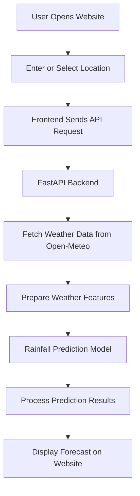

# 🌧️ Smart Rainfall Prediction System

A Smart Weather Forecasting and Rainfall Prediction Web Application using Machine Learning and Live Weather Data.

## 1. 🎯 Aim

To develop a smart rainfall prediction system that uses machine learning techniques and live weather data to provide rainfall-related forecasts through a user-friendly web application.

## 2. 📌 Project Overview

The Smart Rainfall Prediction System is a web-based application designed to provide weather forecast information and rainfall-related predictions.

The project integrates a FastAPI backend with the Open-Meteo weather API and a frontend developed using HTML, CSS, and JavaScript. It also includes a saved machine learning model and its feature configuration.

The system aims to make weather information accessible and useful for applications such as agricultural planning, weather monitoring, and environmental analysis.

## 3. 🎯 Objectives

- To obtain weather forecast data from a weather API.
- To process weather-related information for rainfall analysis.
- To integrate a saved machine learning model into the prediction workflow.
- To develop a user-friendly web interface.
- To connect the frontend with the backend through API requests.
- To organize the project into reusable and maintainable components.

## 4. ❗ Problem Statement

Rainfall information is important for agriculture, water management, and daily planning. However, users may find it difficult to access weather information through technical tools or interpret weather data efficiently.

The project addresses this problem by providing a web-based interface that connects to weather data services and supports rainfall-related forecasting through a backend application and a machine learning model.

## 5. 💡 Proposed Solution

The proposed system combines live weather data, backend processing, a web interface, and a saved machine learning model.

### 🔄 Proposed Solution Flowchart



## 6. ✨ Key Features

- Live weather forecast integration.
- FastAPI-based backend.
- Web-based user interface.
- Saved machine learning model.
- Organized frontend, backend, data, and model directories.
- Jupyter notebooks for experimentation and analysis.
- Modular project structure for future improvements.

## 7. 🏗️ System Architecture

The system is organized into the following components:

**1. Presentation Layer — Frontend**
- `index.html` provides the website structure.
- `style.css` defines the design and layout.
- `script.js` handles user interactions and API communication.

**2. Application Layer — Backend**
- `backend/main.py` contains the FastAPI application.
- `backend/test_pipeline.py` contains pipeline-related tests.

**3. Weather Data Layer**
- The Open-Meteo API provides weather forecast information.

**4. Machine Learning Layer**
- `model/rainfall_model.joblib` stores the saved model.
- `model/feature_config.joblib` stores the associated feature configuration.

**5. Supporting Layer**
- `data/` contains project data.
- `notebooks/` contains Jupyter notebooks.
- `reports/` contains project reports.

## 8. 🛠️ Technology Stack

| Technology | Purpose |
|---|---|
| Python | Backend programming |
| FastAPI | API development |
| Open-Meteo API | Weather forecast data |
| HTML | Webpage structure |
| CSS | Website styling |
| JavaScript | Frontend interactions |
| Joblib | Saving and loading model-related objects |
| Jupyter Notebook | Data analysis and experimentation |
| GitHub | Source code hosting and version control |

Pandas, NumPy, and Scikit-learn may also be used if included in the actual implementation.

## 9. 📂 Project Structure

```text
Smart-Rainfall-Prediction-System/
│
├── backend/
│   ├── main.py
│   └── test_pipeline.py
│
├── data/
│
├── frontend/
│   ├── index.html
│   ├── style.css
│   └── script.js
│
├── model/
│   ├── rainfall_model.joblib
│   └── feature_config.joblib
│
├── notebooks/
├── reports/
│
├── README.md
├── requirements.txt
└── requirements-notebooks.txt
```

## 10. 📊 Results

The project combines a web interface, a FastAPI backend, live weather data access, and saved machine learning model files.

The application is intended to present forecast information and rainfall-related predictions. Actual prediction quality depends on the trained model, input features, and testing results.

Quantitative performance metrics should be added after evaluating the model on suitable test data.

## 11. 🖥️ Project Demonstration

The project demonstration can include the following steps:

1. Open the rainfall prediction website.
2. Select or enter a location, if supported.
3. Request the available weather forecast.
4. Observe the frontend's interaction with the backend.
5. View the forecast or prediction output.
6. Demonstrate the API endpoints using FastAPI's interactive documentation at `/docs`.

**Screenshots to add:**
- Homepage of the application.
- Weather input or location selection.
- Forecast or prediction output.
- FastAPI API documentation.
- Model evaluation results, if available.

## 12. 🚀 Setup and Installation

### Prerequisites

- Python installed on your system.
- Internet connection for live weather data.
- A web browser.

### Step 1: Clone the Repository

```bash
git clone https://github.com/manjot-15058/Rainfall-Prediction-System.git
cd Rainfall-Prediction-System
```

### Step 2: Install Dependencies

```bash
pip install -r requirements.txt
```

For notebook-related dependencies, run:

```bash
pip install -r requirements-notebooks.txt
```

### Step 3: Start the Backend

From the project root, try:

```bash
uvicorn backend.main:app --reload
```

If that import path does not work, open the `backend` folder and run:

```bash
uvicorn main:app --reload
```

### Step 4: Open the API Documentation

Visit the following address in your browser after starting the backend:

http://127.0.0.1:8000/docs

### Step 5: Open the Frontend

Open `frontend/index.html` in a browser if the frontend is a standalone static website. If the project requires a local server or additional configuration, follow the actual frontend setup.

## 13. 🔮 Future Scope

- Improve prediction accuracy through model evaluation and tuning.
- Integrate additional weather features.
- Add interactive weather charts and visualizations.
- Improve location search and user experience.
- Add historical rainfall analysis.
- Deploy the application online.
- Extend the system for agricultural and water resource planning.

## 14. 👩‍💻 Developed By

**Project Name:** Smart Rainfall Prediction System

**Team Members:**
- Bavneet Kaur
- Ritika
- Manjot Kaur

**Department:** Artificial Intelligence and Data Science  
**University:** CT University

## 15. 🎓 Project Outcome

The project provides a foundation for a web-based rainfall forecasting application by combining a frontend interface, a FastAPI backend, live weather data access, and saved machine learning model files.

It demonstrates the practical integration of web development, API communication, and machine learning components in an academic project.

## 16. ✅ Conclusion

The Smart Rainfall Prediction System demonstrates how weather data services, machine learning components, and web technologies can be combined in one application.

The project provides a foundation for accessible weather forecasting and rainfall-related analysis. Further model evaluation, testing, and deployment can improve its reliability and usefulness.

---

**⭐ Developed for academic and educational purposes.**
